<div align="center">


# FlintBench

**Every project on your machine, in one place. Know where you left off and get back to work in seconds.**

A local control center for developers: your projects, their Git state, what is running, your editors,
your AI agents and your GitHub repositories, one click away. It runs on `localhost` and never phones home.


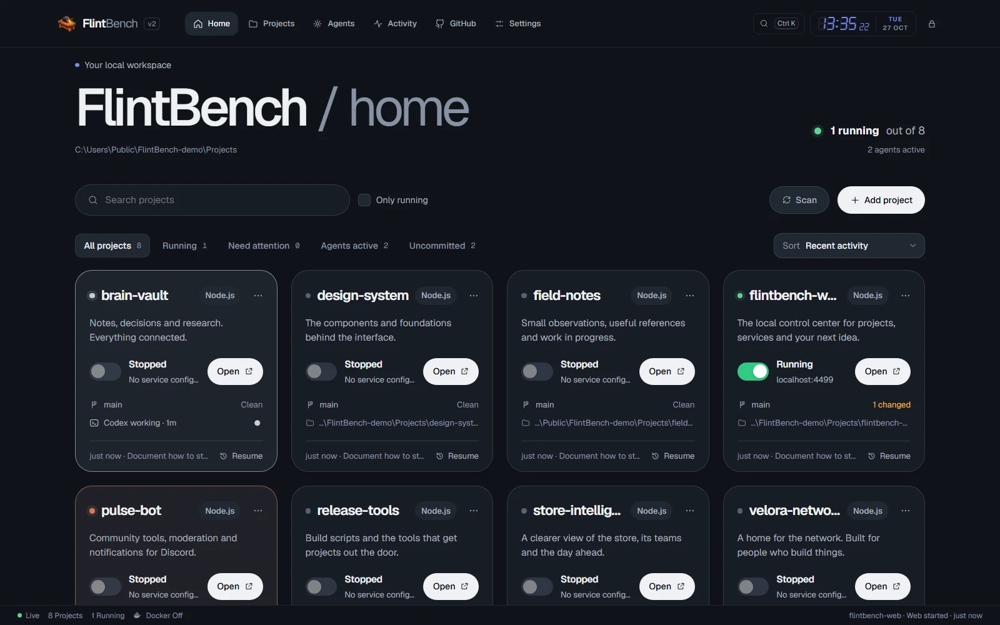

</div>

---

## Why FlintBench

You work on many projects, with many tools: a terminal here, VS Code there, an AI agent in another
window, a dev server you started an hour ago. FlintBench watches all of it **passively** and keeps
the state of every project in one place, so coming back to one takes seconds, not minutes.

> **Work however you want. FlintBench keeps track.**

- **Nothing to change in your habits.** Commit from your terminal, start `npm run dev` wherever you
  like, open the project in your editor: FlintBench notices.
- **Built from facts, never invented.** No productivity scores, no AI-written summaries: what you
  see is what happened in your folders, in Git and in your tools.
- **Works without Git and without agents.** Git makes it richer, agents are optional; the basics
  work for any folder.

## What's new in v2

Version 2 redesigns the whole console around a new home made of project cards, and adds themes,
a live background and an always-on clock. Everything from v1 (services, terminals, Git, GitHub,
agents, profiles) works as before.

- **A home made of cards.** Four columns on a wide screen down to one on a phone. Each card shows
  the project's state, its real description (from `package.json`), a Start/Stop switch, *Open*,
  branch and uncommitted changes, the last commit and *Resume*. A `⋯` menu and right-click give
  editors, agents, files and project management.
- **Live activity inside the cards.** When Claude Code, Codex, Gemini or Antigravity is working,
  or an editor is saving files, the card takes the tool's colour and shows an animated signal.
  A waiting agent stays still; with reduced motion the signal is shown without movement.
- **Search, sort and quick filters** above the grid: all, running, need attention, agents active,
  uncommitted. Newly detected projects wait in a collapsible section under the grid.
- **Top navigation** instead of the side rail, with the command palette, the clock and the lock
  always in reach; on small screens it folds onto two rows.
- **Six colour themes** (Graphite, Blue hour, Pine, Dusk, Ember, Carbon), each dark and light, plus
  any accent colour you like.
- **Video backgrounds**, each in a seamless loop and also behind the lock screen:
  - **Blue hour**: a city skyline over a calm river just after sunset;
  - **Night sky**: clouds drifting over a town at dusk, in time-lapse;
  - **Fireworks**: New Year's fireworks over Dubai;
  - **Red and blue**: soft red and blue geometric shapes on black.

  Blur (0–40 px) and transparency of bars and cards (0–60%) are yours to set, and the animation
  can be turned off.
- **Text size from 75 to 150%**, in 5% steps with `−` and `+` or typed by hand; the interface
  grows with the text.
- **LED clock in the top bar**, in every section and inside projects: time, seconds, day and date.
  Click it for the full date, the week and a timer; during a countdown the time left replaces the date.
- **Agents section**: *Start in…* launches any installed agent in a project; active sessions have
  *Show terminal*, *Conversation* and *Stop*; a journal filterable by agent and project.
- **Profiles you can tweak**: change the accent, density or any feature in Settings and the
  profile becomes *Custom*, keeping everything else; undo the last difference and you are back.
- **Sliders or typed numbers** for every numeric setting (scan depth, blur, transparency, voice
  volume, auto-lock).
- **Project terminal beside the project menu**, also full screen, with animated open, close,
  maximise and restore.

## A tour

<table>
  <tr>
    <td width="50%">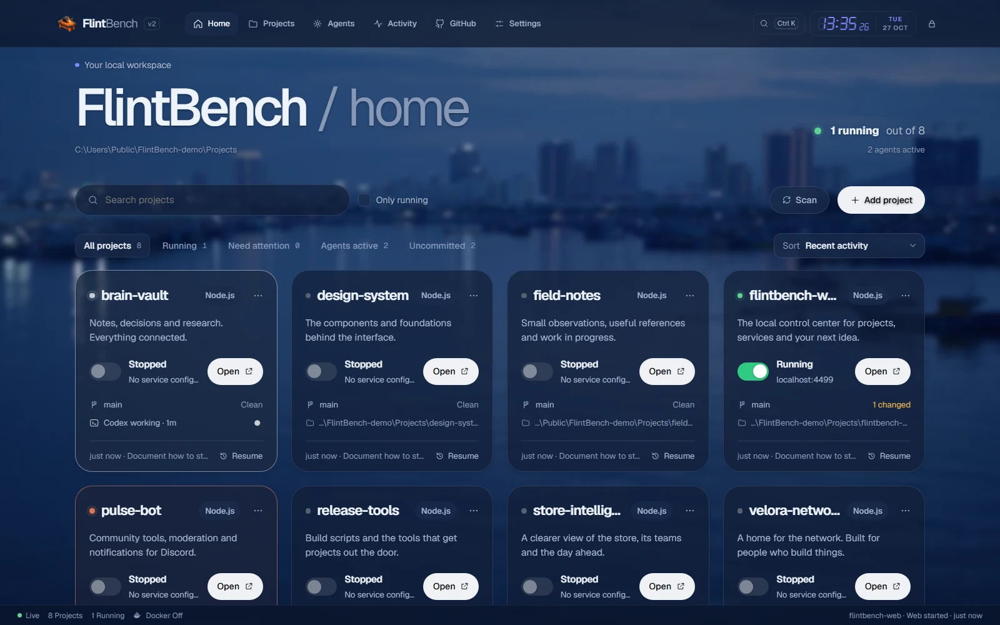</td>
    <td width="50%">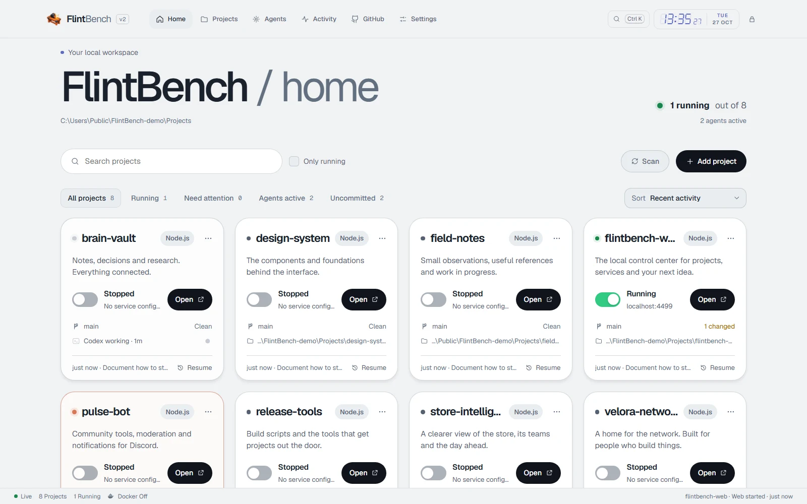</td>
  </tr>
  <tr>
    <td><b>Blue hour</b><br>The video background with blur and translucent cards; the colour theme follows.</td>
    <td><b>Light theme</b><br>Every colour theme comes in dark and light; System follows your OS.</td>
  </tr>
  <tr>
    <td>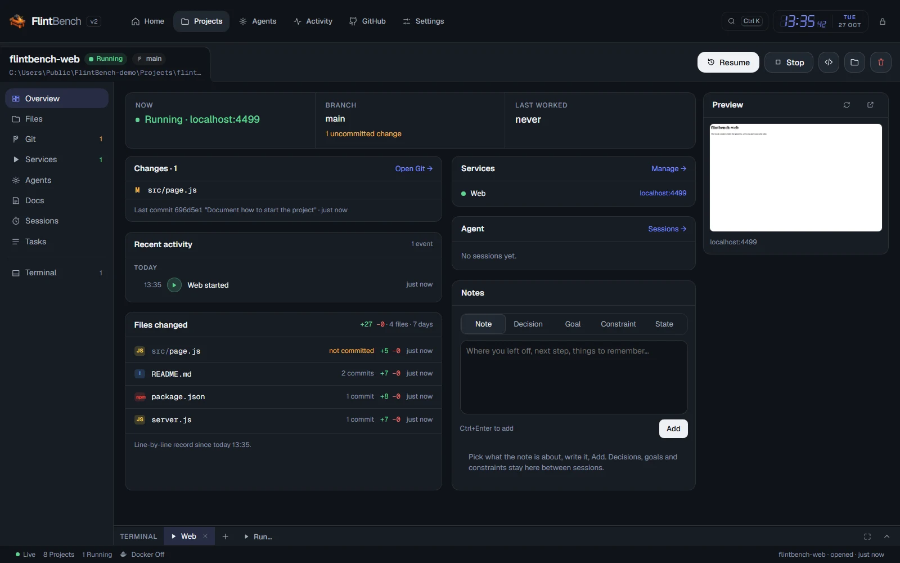</td>
    <td>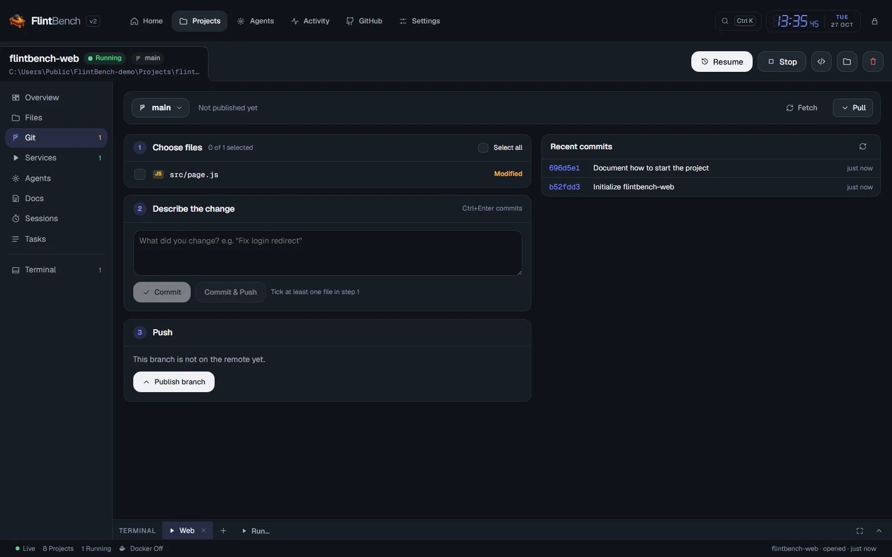</td>
  </tr>
  <tr>
    <td><b>Project overview</b><br>Now, branch and last work; changes, activity, files changed with lines added and removed, services, agent, notes and the live page preview.</td>
    <td><b>Git in three steps</b><br>Choose files, describe the change, push. Branches and recent commits on the side.</td>
  </tr>
  <tr>
    <td>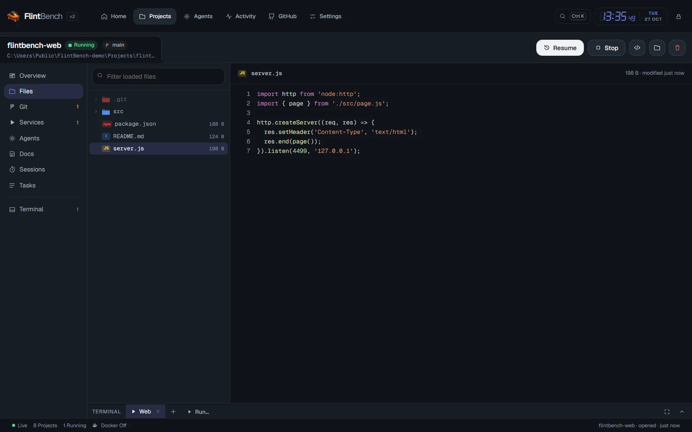</td>
    <td>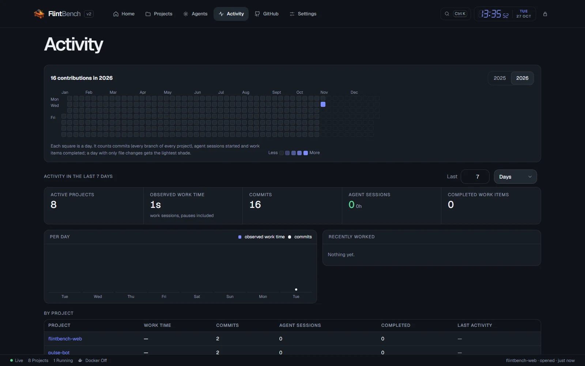</td>
  </tr>
  <tr>
    <td><b>Files</b><br>The project tree and any file, highlighted; open it in your editor from the right-click menu.</td>
    <td><b>Activity</b><br>A year of contributions, work time, commits and agent sessions, per day and per project.</td>
  </tr>
  <tr>
    <td>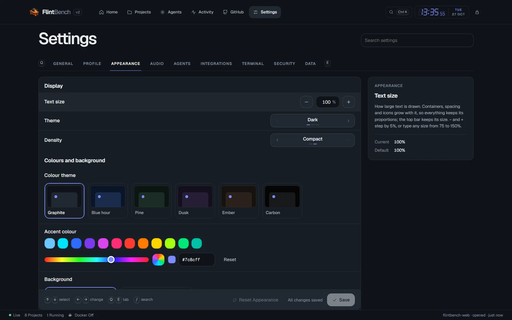</td>
    <td>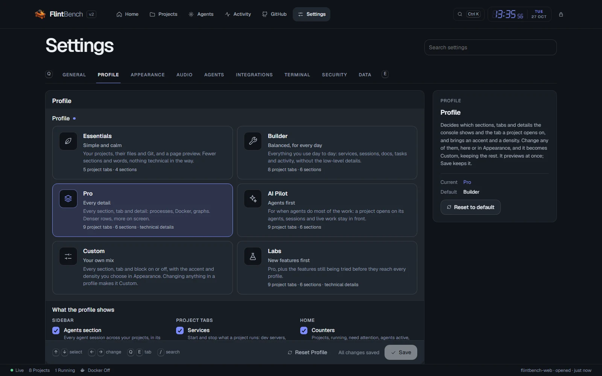</td>
  </tr>
  <tr>
    <td><b>Appearance</b><br>Text size, theme, density, colour theme, accent, background, blur and transparency.</td>
    <td><b>Profiles</b><br>Pick a profile and see what it shows; change any detail and it becomes Custom.</td>
  </tr>
  <tr>
    <td>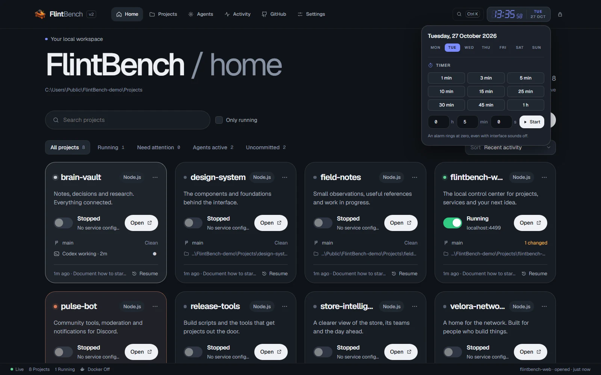</td>
    <td>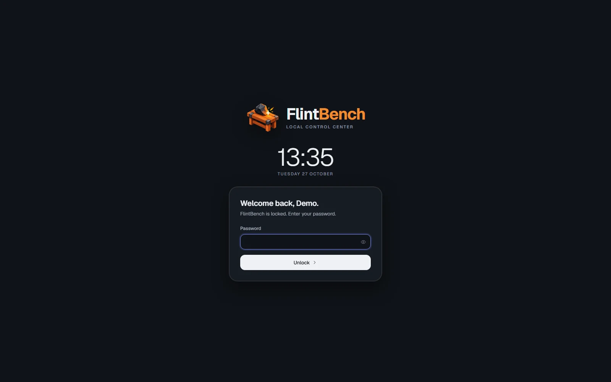</td>
  </tr>
  <tr>
    <td><b>Clock and timer</b><br>Always in the top bar; one click for the date, the week and a countdown.</td>
    <td><b>Locked when you step away</b><br>A local account with password and optional PIN; FlintBench locks itself after a while.</td>
  </tr>
  <tr>
    <td></td>
    <td></td>
  </tr>
  <tr>
    <td><b>A one-minute setup</b><br>A few questions on first launch: experience, AI agents, editors, GitHub, Docker, notifications and project folders.</td>
    <td><b>Your profile</b><br>The setup recommends one and explains why; pick another or build your own.</td>
  </tr>
</table>

<p align="center">
  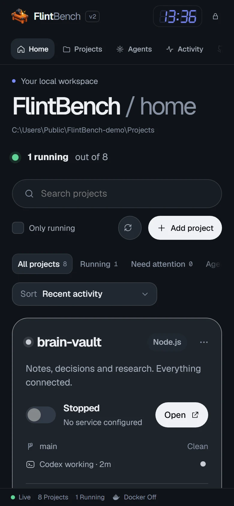
  <br><sub>On a phone: one column, the navigation scrolls under the brand and the clock.</sub>
</p>

## Highlights

| | |
| --- | --- |
| 🗂️ **Every project at a glance** | A card per project with what is happening now, its branch and uncommitted changes, and when you last touched it. One click filters running, dirty, agent-active or attention-needing projects. |
| ⏪ **Pick up where you left off** | Each project opens on a briefing: what changed, the last commit, the task in progress, your notes and decisions. *Resume* brings back services, terminals and the last conversation. |
| 🖥️ **Live page preview** | Web apps show a picture of the page they serve, even when you started the dev server yourself. When it stops, the preview says *Offline* over the last picture. |
| 🌿 **Git without leaving** | Pick files, describe, commit and push in three steps; branches, history and a diff for every file. Commits and pushes made elsewhere arrive as notifications. |
| 🐙 **Your GitHub, managed here** | Every repository of your account: clone, create, edit, archive, delete. A repository that is already a project opens its Git tab. |
| 🤖 **AI agents, when you use them** | Start, follow and resume Claude Code, Codex, Gemini or Antigravity CLI in a project, and see them work right on the home cards. They keep their own login: FlintBench stores no API key. |
| ▶️ **Services and terminals** | Start and stop dev servers, tests and Docker containers; a terminal per project. *Stop* also ends a dev server you started in your own terminal. |
| 🎨 **Shaped around you** | A profile (Essentials, Builder, Pro, AI Pilot or Custom) decides which sections, tabs and details you see; themes, accent, background and text size make it yours. |

## Profiles

The profile is how you change what FlintBench shows. Theme, colour theme, background and text size
stay yours whatever the profile; changing the accent, the density or a feature makes the profile
*Custom*, starting from the one you had.

| | Essentials | Builder | Pro | AI Pilot | Custom |
| --- | :-: | :-: | :-: | :-: | :-: |
| **For** | just starting | every day | every detail | agents first | you decide |
| Sections: Agents, Activity | – | ✓ | ✓ | ✓ | your choice |
| Tabs: Agents, Docs, Sessions | – | ✓ | ✓ | ✓ | your choice |
| Tab: Graph | – | – | ✓ | ✓ | your choice |
| Files changed, agent block | – | ✓ | ✓ | ✓ | your choice |
| Technical details (Docker, processes) | – | – | ✓ | – | your choice |
| A project opens on | Overview | Overview | Overview | Agents | your choice |
| Density | comfortable | comfortable | compact | comfortable | your choice |

Answer *No* to "Do you build with AI agents?" and every agent button, tab and section disappears,
whatever the profile.

## Quick start

**Requirements**

- [Node.js](https://nodejs.org) **24.7 or newer** (FlintBench uses the built-in `crypto.argon2`)
- [Git](https://git-scm.com) on `PATH`
- Optional: [Docker](https://www.docker.com), an editor (VS Code, Cursor, Windsurf, Zed, Sublime Text,
  JetBrains IDEs…), the [GitHub CLI](https://cli.github.com), AI agents (Claude Code, Codex, Gemini, Antigravity CLI)

**Run**

```bash
git clone https://github.com/veloranetwork8x/flintbench.git
cd flintbench
npm install
npm start            # then open http://localhost:4477
```

On first launch FlintBench asks you to create a local account (username, password, optional PIN),
then runs the setup and opens the console. Coming from v1? Your `data/` folder is kept as it is:
same account, projects and settings.

| Variable | Default | Purpose |
| --- | --- | --- |
| `FLINTBENCH_PORT` | `4477` | HTTP port |
| `FLINTBENCH_HOST` | `127.0.0.1` | Loopback only (`localhost`, `::1` also allowed) |
| `FLINTBENCH_DATA_DIR` | `./data` | Where FlintBench keeps its state |

`npm run dev` restarts the server when its code changes. `npm run reset-setup` brings back the
first run at the next start: the current account is kept aside, never deleted.

## Integrations

| Tool | What FlintBench does with it |
| --- | --- |
| **Editors** | Opens a project or a file in your default editor; the others you use are in the menus. VS Code, Cursor, Windsurf, Antigravity, VSCodium, Zed, Sublime Text, WebStorm, IntelliJ IDEA, PyCharm. |
| **Git** | Live status of every repository, whoever changes it; commit, push, pull, branches, diffs. |
| **GitHub CLI** | Lists and manages your repositories and publishes new ones. Sign in once with `gh auth login` (or from FlintBench): FlintBench never sees your token. |
| **Docker** | Compose services and containers per project, started and stopped with it; *Docker Up/Down* in the status bar. |
| **AI agents** | Claude Code, Codex, Gemini and Antigravity CLI started in the project folder, followed and resumed; sessions started elsewhere are recognised. |

## Keyboard

| Keys | Action |
| --- | --- |
| `Ctrl/⌘ K` (or `Ctrl Shift P`) | Command palette: jump to a project, run a command, set a timer |
| `Alt 1…6` | Home, Projects, Agents, Activity, Settings, GitHub |
| `/` | Search projects |
| `↑ ↓` / `j k`, `Enter` | Move and open on the home |
| ``Ctrl ` `` | Show or hide the terminal |
| `Ctrl Enter` | Commit (in the commit box) |
| `Q` / `E` | Previous / next tab in Settings |
| `Ctrl Shift L` | Lock |

## Privacy and security

- **Local only.** The server listens on loopback; requests from other hosts and origins are refused.
- **No account in the cloud, no telemetry, no database.** Everything lives in the data folder.
- **No API keys.** Agents and the GitHub CLI keep their own sign-in.
- **Your repositories are only read**, except for actions you trigger (Git, terminal, services, agents).
- **Passwords and PINs** are stored only as Argon2id hashes; browser sessions are hashed too.

Everything FlintBench owns is in `data/`:

```text
data/
├─ auth.json               argon2id hashes only
├─ settings.json
├─ projects.json
├─ ignored-projects.json
├─ projects/<id>/          notes, tasks, activity, sessions, file history, preview
└─ runtime/                instance lock, browser sessions (hashed)
```

Delete the `flintbench` folder (or only `data/`) to remove FlintBench and everything it stored.
Your projects are never stored there and never deleted.

## Good to know

- **Processes started outside FlintBench** are recognised by their command line or, for a server
  listening on a port, by the folder it runs in. A process that shows neither is not attributed.
- **External agent sessions** are detected from the agents' own session files (names, times and
  working folder only, never the conversation unless you turn on the live transcript).
- **Linux**: deep file changes are picked up by a periodic check instead of a recursive watcher.
- **The PIN** unlocks only a browser that already signed in with the password.
- Terminals and services started by FlintBench stop when FlintBench stops.

## Testing

```bash
node qa/verify.mjs
```

An end-to-end check in Chromium with real HTTP, Git, PTY and WebSocket: account creation, cards,
live activity, search and filters, start/stop, themes, the Blue hour background, profiles, the
terminal, lock and unlock, at eight widths from 320 to 1920 px, with and without reduced motion.
It needs Playwright with Chromium (`npm install --no-save playwright` then
`npx playwright install chromium`, or point `FLINTBENCH_PLAYWRIGHT` at an existing install). It
runs on port 4488 with its own data and fixture repositories in `qa/.runs/`, and writes its report
to [docs/v2/verification.json](docs/v2/verification.json). Design notes for v2 are in
[PROJECT-DESIGN.md](PROJECT-DESIGN.md).

## Built with

Plain Node.js (HTTP, `fs.watch`, `crypto.argon2`) and vanilla JavaScript modules: no framework, no
build step. [ws](https://github.com/websockets/ws) for live updates,
[node-pty](https://github.com/microsoft/node-pty) and [xterm.js](https://xtermjs.org) for the
terminals, [Geist](https://vercel.com/font) and [Nerd Fonts](https://www.nerdfonts.com) symbols for type.
The background videos come from [Pexels](https://www.pexels.com) (credits in `app/web/media/README.md`).

## License

[MIT](LICENSE). Bundled fonts and media keep their own licenses (see `app/web/fonts` and `app/web/media`).
